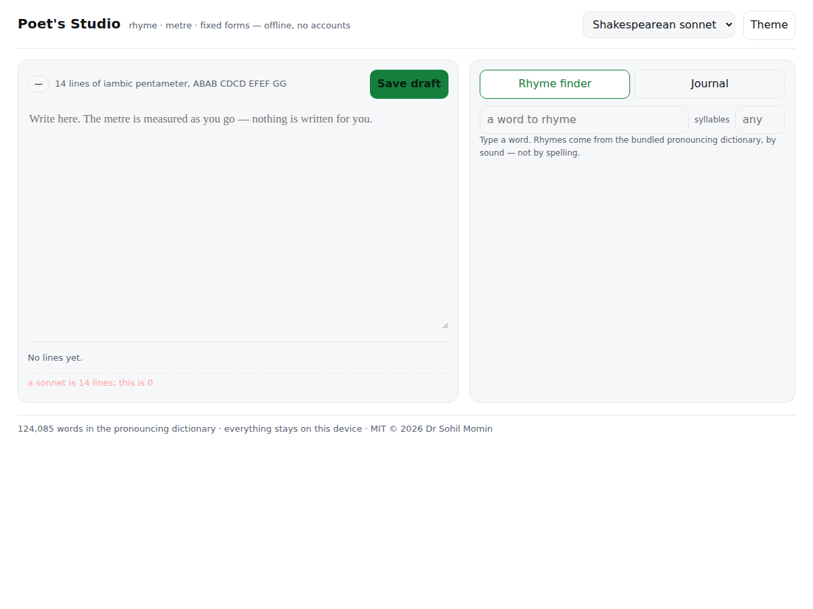

# Poet's Studio

<!-- shot:start -->



<!-- shot:end -->

[](https://drsamonline.github.io/app-poets-studio/play/)
[](https://github.com/drsamonline/app-poets-studio/actions/workflows/test.yml)
[](LICENSE)
[; when it is not, it is not named.
- **Fixed forms as constraints that check you** — Shakespearean sonnet, haiku,
  ghazal, and a custom stanza with your own syllable counts and scheme. Each is
  a live pass/fail with the reason, per line.
- **Writing journal** — drafts, versions and notes, all on the device. Export one
  poem, the whole journal as JSON, or every draft as a ZIP.

## The three rhyme strengths

| | | |
|---|---|---|
| **Perfect** | the same sound from the last stressed vowel | `wall` / `fall`, `day` / `grey` |
| **Near** | the same consonant frame, a different vowel | `cat` / `cot`, `love` / `move` |
| **Slant** | the same stressed vowel, a different ending | `cat` / `cap` |

## The dictionary, and its size

`docs/play/dict.js` carries the **CMU Pronouncing Dictionary** — **124,085
words**, one pronunciation each — inside the app, so rhyme and metre work with
no network and no model.

It ships in a single-character ARPAbet encoding (each phoneme is one printable
character at `33 + its index in Poetry.ALPHABET`), which is **1.9 MB of text
instead of 3.6 MB** and decodes in one pass. The tab that separates the word
from its phonemes is what marks a line as encoded, so a plain `word P1 P2`
dictionary can still be pasted in by hand.

The dictionary is BSD-2-Clause and its licence travels with it in
[NOTICE.md](NOTICE.md).

## What it refuses to do

- **Write the poem.** There is no generator, no prompt box, no suggestion engine.
- **Guess at a word it does not know.** An unknown word is named in the line
  and counted as one syllable, and the line is marked inexact — a metre count
  that is quietly wrong is worse than one that says it is unsure.
- **Call an irregular line regular.** A metre is only named when at least 60% of
  its feet fit; otherwise the pattern is shown and the name is left off.

## Run it

Open `docs/play/index.html`. That is the whole app — the kits and the dictionary
sit next to it, so it works from `file://` and from GitHub Pages.

```
node test-node.js      # 76 assertions, no dependencies
```

## How it is built

| | |
|---|---|
| `docs/play/index.html` | the app — one page, no build step |
| `docs/play/poetry.js` | the engine: syllables, stress, rhyme, metre, forms. Works in the browser and in Node, so the tests test the app |
| `docs/play/dict.js` | the bundled dictionary |
| `docs/play/web-kit.js` | shell, storage, theme, i18n, CSV |
| `docs/play/search-kit.js` | ranked search |
| `docs/play/export-kit.js` | files and ZIP off the device |

The form checks are deliberately honest about the difference between a
*dictionary* stress and a *verse* stress: CMUdict marks `is` and `a` as primary
stressed, which no one beats in a line, so a sonnet line is allowed to depart
from the ideal pattern in up to 20% of its syllables rather than being held to a
perfection no real sonnet has.

## Licence

PolyForm Noncommercial 1.0.0 — free for any noncommercial purpose. Commercial use
needs a licence from the author. See [`LICENSE`](LICENSE).

The bundled dictionary keeps its own **BSD-2-Clause** licence, and that licence
travels with it.

