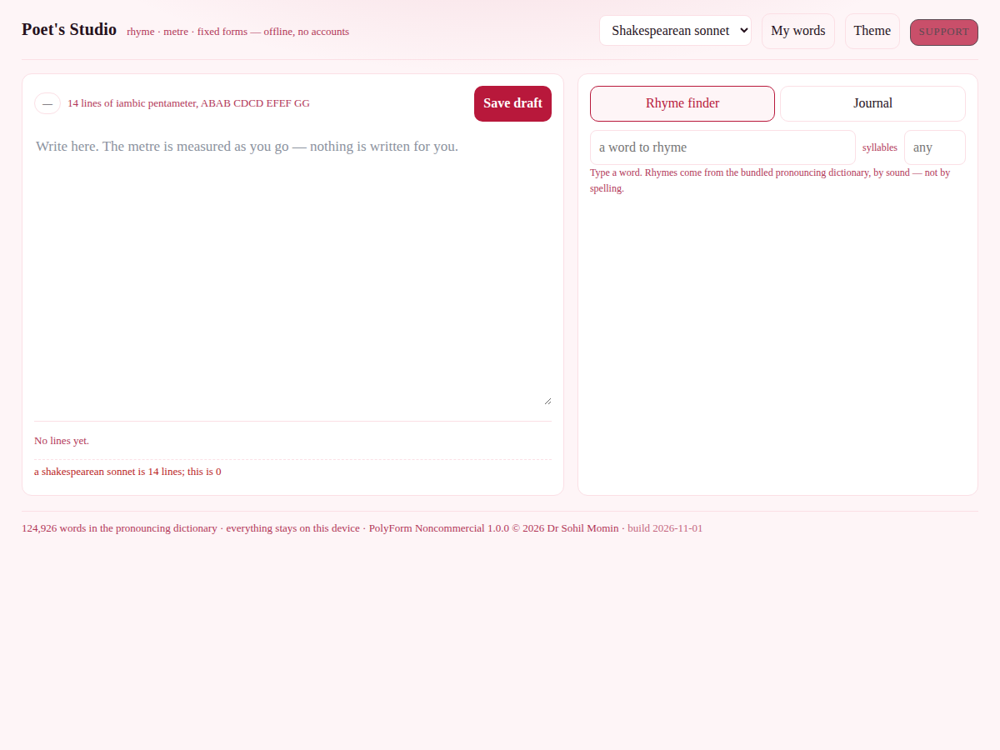

# Poet's Studio


**Rhyme, metre and fixed forms — a workshop that measures what you actually wrote.**
Offline, no accounts, no telemetry, no generator. The whole 124,926-word pronouncing
dictionary travels inside the app.

[Live app](https://drsamonline.github.io/app-poets-studio/play/) ·
[Landing page](https://drsamonline.github.io/app-poets-studio/) ·
[What it refuses to do](#what-it-refuses-to-do) ·
[Sources](#the-dictionary-and-its-size) ·
[Enhancements](ENHANCEMENTS.md)

<!-- shot:start -->



<!-- shot:end -->

Master list **#130** · built from `QUEUE/app-poets-studio.md`.

## What it does

- **Rhyme finder** — perfect, near and slant rhymes, found by *sound* from a
  pronouncing dictionary, with a syllable filter. Spelling is not consulted, so
  `though` and `cough` are correctly told apart and `say` rhymes with `away`.
- **Syllable and metre counter** — every line, with its stress pattern shown as
  a running bar. When the line is regular the metre is named; when it is not, it
  is not named, and the message names the **foot** that broke and which way the
  beat falls there.
- **The scheme as you are making it** — the gutter letters each line ending A, B,
  C … in order of first appearance, so you see the rhyme you are actually
  writing rather than the one you meant to write.
- **Fixed forms as constraints that check you** — Shakespearean sonnet, blank
  verse, terza rima, rubaiyat quatrain, haiku, tanka, limerick, ghazal, and a
  custom stanza with your own syllable counts and scheme. Each is a live
  pass/fail with the reason, per line.
- **A ghazal in Devanagari or Gujarati** — measured in *mātrā*, not in English
  phonemes. Every line of a couplet must share the same count, which is the
  practical test of a shared beher; the script is named under the form.
- **Two readings where a word has two** — `record`, `present`, `wind`, `read`,
  `blessed`, `learned` and their kind keep both pronunciations, and the metre
  picks the one the line asks for.
- **Samples to load** — a sonnet that passes, a haiku, a tanka, a ghazal with a
  radif, a ghazal in Devanagari, and one haiku that is a syllable long in its
  first line so you can see the app say so. They live in `docs/play/samples.js`, and the tests assert the
  verdict each one is there to demonstrate.
- **My words** — teach it a name, a dialect form or an invented word by giving
  its sounds in ARPAbet. It is appended to the dictionary text before parsing, so
  the metre and the rhyme finder treat it like any other word. It stays on the
  device.
- **Writing journal** — drafts, versions and notes on the device, kept in
  IndexedDB rather than localStorage so a journal of versions is not up against a
  5 MB ceiling: import a journal as well as export it, diff two versions line by
  line, rename, copy, and undo a delete. Two tabs on the same journal tell each
  other when one of them saves, so neither silently reverts the other. Export one
  poem, the whole journal as JSON, or every draft as a ZIP.
- **Print** — `Ctrl/Cmd+P` gives the poem and its measure, without the furniture.

## The three rhyme strengths

| | | |
|---|---|---|
| **Perfect** | the same sound from the last stressed vowel | `wall` / `fall`, `day` / `grey` |
| **Near** | the same consonant frame, a different vowel | `cat` / `cot`, `love` / `move` |
| **Slant** | the same stressed vowel, a different ending | `cat` / `cap` |

## The dictionary, and its size

`docs/play/dict.js` carries the **CMU Pronouncing Dictionary** — **124,926
words** and **133,971 pronunciations** — inside the app, so rhyme and metre work
with no network and no model. Every pronunciation is kept, not one per word: 8,383
words have more than one reading, and those are the words a poet notices. `fire`
measures as one syllable or two, `read` as *reed* or *red*, depending on the line.

It ships in a single-character ARPAbet encoding (each phoneme is one printable
character at `33 + its index in Poetry.ALPHABET`), which is about half the bytes of
the plain text and decodes in one pass. Extra readings of the same word follow the
first on the same line, separated by `|`. The derivation is reproducible:
`python3 scripts/build-dict.py path/to/cmudict.dict`. The tab that separates the word
from its phonemes is what marks a line as encoded, so a plain `word P1 P2`
dictionary can still be pasted in by hand — which is exactly how **My words**
works.

Around thirty elided and archaic forms the dictionary has never met —
`dimm'd`, `ow'st`, `grow'st`, `wander'st`, `ne'er`, `o'er`, `'tis`, `heav'n` —
carry a hand-written pronunciation in `poetry.js`, so a real sonnet is not marked
inexact for its apostrophes.

The dictionary is BSD-2-Clause and its licence travels with it in
[NOTICE.md](NOTICE.md).

## The mātrā counter

A syllable in Devanagari or Gujarati is a written unit, not a vowel phoneme: a
consonant carries its inherent *a* (1 mātrā), a mātrā sign replaces it with its own
weight, and a halant kills it — so `कल` is 2, `काल` is 3, and `क्` is 0. Anusvara and
chandrabindu nasalise the vowel they follow and add nothing.

The ghazal uses that count directly. Two lines that share a beher share a mātrā
count, so that is what the form checks, line by line, and reports. Urdu script is
deliberately **not** counted: its short vowels are not written, so a mātrā count
there would be a guess dressed up as a measurement.

## What it refuses to do

- **Write the poem.** There is no generator, no prompt box, no suggestion engine.
- **Guess at a word it does not know.** An unknown word is named in the line
  and counted as one syllable, and the line is marked inexact — a metre count
  that is quietly wrong is worse than one that says it is unsure.
- **Call an irregular line regular.** A metre is only named when at least 60% of
  its feet fit; otherwise the pattern is shown and the name is left off.
- **Reach the network.** No `fetch`, no `XMLHttpRequest`, no socket, anywhere in
  the app — and a test asserts it.

## Run it

Open `docs/play/index.html`. That is the whole app — the kits, the samples and
the dictionary sit next to it, so it works from `file://` and from GitHub Pages.

```
node test-node.js             # 136 assertions, no dependencies
node test-ui.mjs              # the page in a real DOM (needs jsdom, harness only)
node scripts/build-single.mjs # one self-contained dist/poets-studio.html
bash scripts/icons.sh         # the icon set, from docs/icon.svg
python3 scripts/badges.py     # the badges, drawn locally
bash scripts/shot.sh app sonnet
bash scripts/release-notes.sh --dry-run
```

Over http(s) the app also **installs itself**: `sw.js` caches the six files once,
so afterwards it opens from an icon with the network off. The page is served
network-first and the cache name is bumped on every release, so a new build is
never hidden behind a stale cache; the footer prints a build stamp so "am I on
the new one?" is answerable from the page itself.

Keyboard: `Ctrl/Cmd+S` save, `Alt+R` rhyme finder, `Alt+1…9` pick a form.

## How it is built

| | |
|---|---|
| `docs/index.html` | the landing page — its own design, with the app embedded live |
| `docs/play/index.html` | the app — one page, no build step |
| `docs/play/poetry.js` | the engine: syllables, stress, rhyme, metre, forms. Works in the browser and in Node, so the tests test the app |
| `docs/play/dict.js` | the bundled dictionary |
| `docs/play/samples.js` | the poems the app can load, with the verdict each one demonstrates |
| `docs/play/web-kit.js` | shell, storage, theme, i18n, CSV |
| `docs/play/export-kit.js` | files and ZIP off the device |
| `docs/play/sw.js` | the service worker: network-first HTML, cache-first assets |
| `docs/play/manifest.webmanifest` | install metadata and the icon set |
| `docs/icon.svg`, `docs/icon-glyph.svg` | the mark, and the mark without its ground |
| `docs/play/icon.png` | the icon the release builds take: the kit reads it from the app directory |
| `scripts/` | badges, icons, the dictionary, screenshots, release notes and the single-file build — all local |
| `packaging/app-poets-studio.desktop` | the Linux launcher entry, with its icon |
| `docs/play/icon*.png` | the icon the builds take — launcher PNGs, and the adaptive layers Android masks |
| `changes/`, `VERSION` | the changelog is written with the change, not reconstructed later |
| `ENHANCEMENTS.md` | what is shipped, what is left, and why the rest is not done |

Deep links open a case directly: `play/#/sonnet`, `#/tanka`, `#/haiku-off`,
`#/ghazal`, `#/ghazal-hindi`, `#/rhyme/though`. The landing page drives the embedded app with the
same slugs over `postMessage`, so switching sample never reloads the dictionary.

The form checks are deliberately honest about the difference between a
*dictionary* stress and a *verse* stress: CMUdict marks `is` and `a` as primary
stressed, which no one beats in a line, so a line is allowed to depart from the
ideal pattern in up to 20% of its syllables rather than being held to a
perfection no real sonnet has.

## Licence

PolyForm Noncommercial 1.0.0 — free for any noncommercial purpose. Commercial use
needs a licence from the author. See [`LICENSE`](LICENSE).

The bundled dictionary keeps its own **BSD-2-Clause** licence, and that licence
travels with it.
